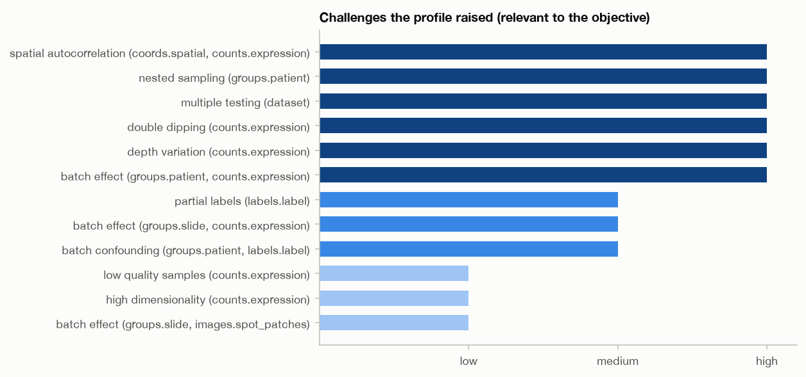
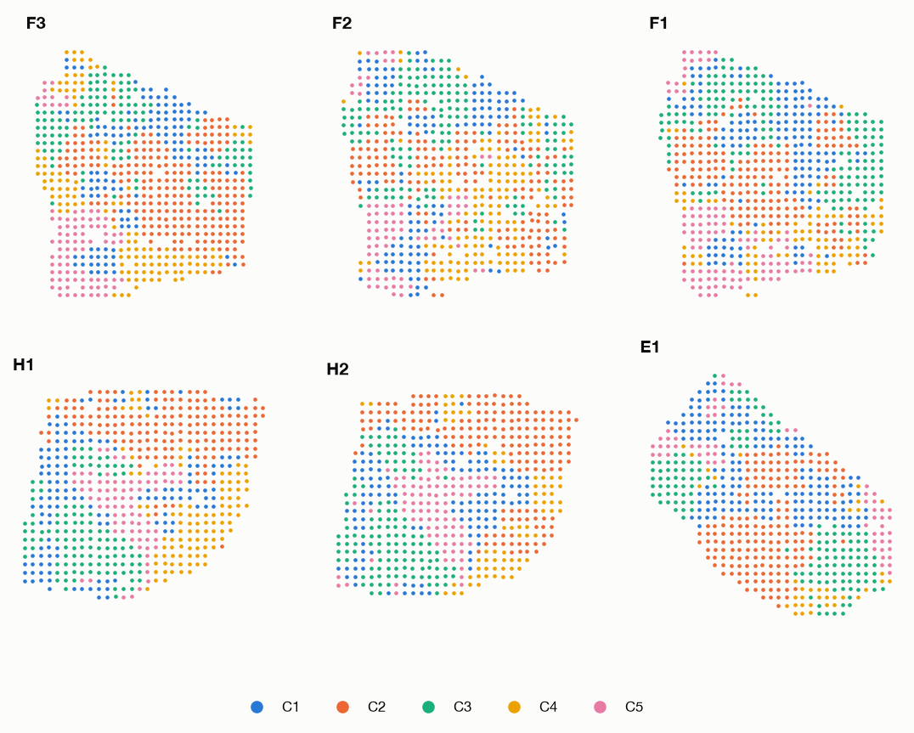
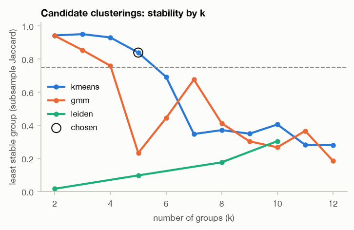
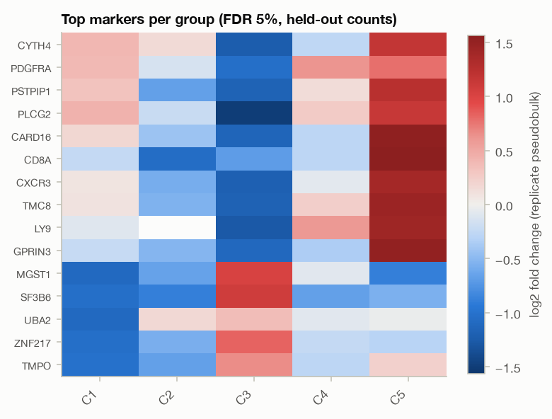
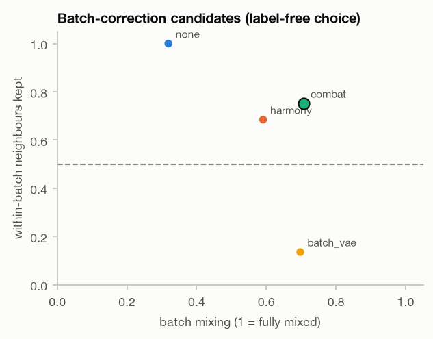
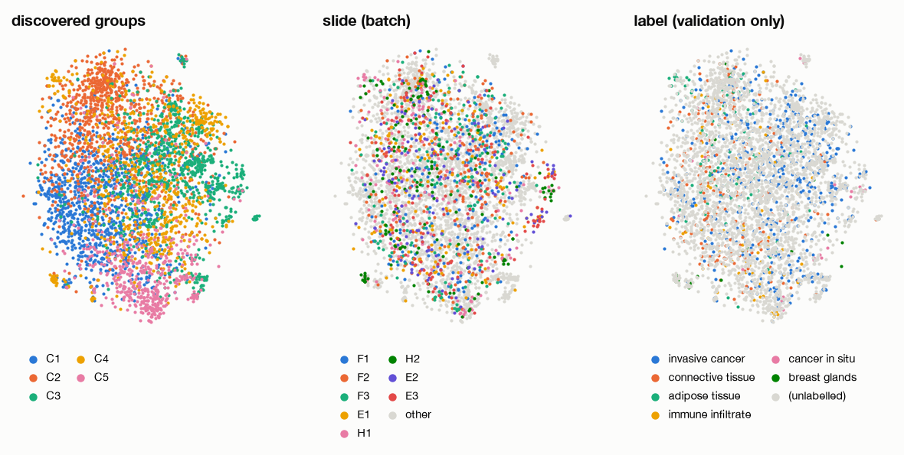

# Analysis report

spatial_anndata data, 13,620 samples; full mode; plan by the llm planner; LLM: claude-opus-5-5, 3 calls, $0.79; 2026-11-02 16:51:51.

## Objective

> Characterize spatial tissue heterogeneity: identify spatial domains, relate them to histology, find marker genes, and assess slide-level batch effects.

| question | read from | about |
|---|---|---|
| structure discovery | identify spatial domains | features: counts.expression |
| spatial structure | Characterize spatial tissue heterogeneity | coords: coords.spatial; features: counts.expression |
| cross modal association | relate them to histology | modalities: images.spot_patches; structure: discovered |
| differential analysis | find marker genes | features: counts.expression; groups: discovered |
| batch assessment | assess slide-level batch effects | batch: groups.slide; outer: groups.patient |
| visualization (implied) | (maps for the report) | features: counts.expression |

## Executive summary

The objective was to describe spatial heterogeneity in a spatial transcriptomics dataset: find spatial domains, relate them to histology, find marker genes and assess slide-level batch effects. The data were 13,620 spots on 36 slides nested in 8 patients. The agent found **5 spatial domains** (k-means on BANKSY-style features with own features plus neighbourhood mean, k=5). The least-stable domain had a subsample Jaccard of 0.838, spatial coherence was 0.638 against 0.279 for own features alone, and every domain occurred in all 8 patients.

- **Markers:** 699 domain markers were found using patient pseudobulk on the held-out half of a count split. All of them kept their sign in every leave-one-patient-out refit (fraction 1.0). The naive per-spot test found 941, 1.346 times as many.
- **Histology:** image features alone predicted the domains above chance under patient-grouped cross-validation (balanced accuracy 0.358, 95% CI 0.296–0.422, chance 0.2). The effect is modest. Agreement with the pathologist label was weak: ARI 0.066, NMI 0.123, on 3,123 labelled spots.
- **Batch effects:** within patients, slide effects were classed as weak (silhouette 0.000344, mixing 0.774). Patient differences dominated (silhouette 0.375, 0.664 of variance). They were removed by ComBat across all slides, which raised mixing from 0.319 to 0.707.
- **Spatially variable genes:** 5,840 of 10,000 features were spatially variable at FDR 0.05, and the test was well calibrated (0.055 of permuted features reached p < 0.05).

Bottom line: the domains are reproducible and spatially coherent, and their markers are robust at the patient level. However, they only partly match the histological annotation, and part of their basis (shared vs patient-specific biology) was set by the decision to correct across patients.

## Data and challenges

**Profile.**
- 13,620 spots; expression present for 13,619.
- 11,871 features; 83% of matrix entries are zero; 0.872 features per sample.
- Spatial coordinates and image patches (from 36 source images) for every spot.
- Slides (36 levels, about 378 spots each) are nested in patients (8 levels, about 1,702 spots each).
- A 6-class histological label covers 23% of spots, on 8 of 36 slides but in all 8 patients.

**Challenges raised (12 relevant, 6 high):**
- **Depth variation (high):** the log2 library-size IQR was 1.86 and per-slide median depth ranged from 636 to 12,194. PC1 tracked log depth with |rho| 0.994 on raw log1p counts and still 0.766 after library-size scaling. This drove per-slide QC thresholds, the normalisation choice and the separate `norm_all` step before the spatially variable gene (SVG) test.
- **Patient batch effect (high):** silhouette by patient was 0.375, neighbour mixing 0.00412, and 0.664 of the variance lay between patients. Patient differences mix biology and technical effects.
- **Slide effect within patient (medium):** silhouette 0.0324, mixing 0.667, and 0.0526 of the variance lay between slides of one patient.
- **Nested sampling (high):** the independent unit is the patient (8 units), which motivated patient-grouped cross-validation and patient pseudobulk.
- **Double dipping (high):** domains discovered from the counts and then tested for markers on the same counts would give inflated significance. Handled by Poisson count splitting.
- **Spatial autocorrelation (high):** 100% of the top 100 variable features had significant Moran's I (median 0.134), so neighbouring spots are not independent.
- **Multiple testing (high):** 9,514 features in each of the marker and SVG families. Handled by Benjamini-Hochberg FDR within each family.
- **Label confounded with patient (medium):** Cramér's V 0.369, so correcting across patients also affects the labelled biology.
- **Image colour batch (low):** 0.126 of image colour variance lay between slides.
- **Low-quality spots (low):** 1.5% failed the per-slide MAD rule. 202 spots were removed, leaving 13,417, and no features were dropped.
- **Partial labels (medium):** only 23% of spots are labelled. Class imbalance (largest class 18.1 times the smallest) was flagged but marked not relevant, because all 6 classes have enough support.

Relevant challenges (all checks, including those that found nothing, are in challenge_register.md):

| challenge | severity | evidence | handled by | remaining risk |
|---|---|---|---|---|
| batch_effect:groups.patient,counts.expression | high | silhouette by patient 0.375; neighbour mixing of patients 0.00412 | batch_assess, batch_correct | mixing after correction 0.707 (before 0.319); groups still separate |
| depth_variation:counts.expression | high | interquartile range of log2 library size 1.86; \|Spearman rho\| of PC1 with log depth after library-size scaling 0.766 | norm, batch_vae, norm_all | \|rho(PC1, depth)\| after normalisation 0.524 |
| double_dipping:counts.expression | high | questions implying discovery then testing differential_analysis, structure_discovery, spatial_structure | split | low: markers are tested on the held-out half of the count split |
| multiple_testing | high | hypotheses the questions imply: features compared between groups 9,514; hypotheses the questions imply: features tested for spatial patterns 9,514 | svg, enrichment, markers | low: Benjamini-Hochberg FDR within every family of tests |
| nested_sampling:groups.patient | high | samples per independent unit (coarsest grouping) 1,702; patient levels 8 | batch_assess, histology, markers | markers rest on 8 replicates per group |
| spatial_autocorrelation:coords.spatial,counts.expression | high | share of variable features with significant Moran's I 1; median Moran's I 0.134 | domains, svg | handled; see the steps' results |
| batch_confounding:groups.patient,labels.label | medium | Cramér's V between group and label 0.369 | batch_assess | handled; see the steps' results |
| batch_effect:groups.slide,counts.expression | medium | silhouette by slide within patient 0.0324; neighbour mixing of slides within patient 0.667 | batch_assess, batch_vae, batch_correct | mixing after correction 0.707 (before 0.319); groups still separate |
| partial_labels:labels.label | medium | share of samples with a label 0.232; slide levels labelled 8 of 36 | validate_label | handled; see the steps' results |
| batch_effect:groups.slide,images.spot_patches | low | between-group share of image colour variance 0.126 | features | handled; see the steps' results |
| high_dimensionality:counts.expression | low | features per sample (p / n) 0.872; share of zero entries 0.827 | norm, pca, batch_vae, norm_all, map | handled; see the steps' results |
| low_quality_samples:counts.expression | low | share of samples failing the default count-QC rule 0.0148; empty samples 0 | qc | handled; see the steps' results |

## Plan

- **QC per slide.** Depth differs between slides (medians 636 to 12,194), so each slide got its own 3-MAD threshold (and at least 2-fold below its median). This removed 202 spots (0.0148). The worst slide lost 0.055, well under the 0.5 limit.
- **Count split before discovery.** Poisson thinning with epsilon 0.5 gave a median dependence of 0.049 between halves (target within 0.05) and a fit-count share of 0.5. Domains were found on one half and markers tested on the other.
- **Normalisation for discovery (`norm`).** Log normalisation was kept: depth correlation was |rho| 0.524 with log versus 0.487 with Pearson residuals, and that gap was below the 0.1 rule, so the more interpretable log scale was preferred. 2,000 variable features were selected within each slide, so features that differ only between slides were not selected. The cost is that the 0.5 depth threshold was missed.
- **PCA.** Features were standardised. Parallel analysis found 51 components above the permutation null, clamped to 50. These explain 0.117 of the variance.
- **Batch assessment (report only).** Slide effects were measured within each patient. Patient differences were deliberately not counted as batch effect.
- **Correction scope (key decision).** Correction was done across all slides, which also removes patient differences. The rationale: markers use the patient as the replicate, so domains must recur across patients. A within-patient correction would leave domains confined to single patients. The rejected alternative was within-patient correction (`within_outer` = no).
- **Correction method.** Harmony, ComBat, a slide-conditioned NB-VAE and no correction were compared, label-free. The VAE used an NB likelihood because ZINB won by AIC for only 4% of genes. It used latent dimension 10, stopped early at epoch 150 with best epoch 125, and had a validation negative ELBO of 0.43 per gene. ComBat was chosen: it had the best mixing (0.707) among candidates that keep at least 50% of within-batch neighbours (0.752). The VAE was not selected.
- **Image features.** Of 3 pretrained encoders screened on patient-held-out pairs, Phikon scored highest (recall@10 0.075 vs chance 0.02). Colour normalisation was rejected because the between-slide colour share (13%) was below the 20% threshold.
- **Domains.** Each spot's features were joined with the mean of its 6 nearest neighbours (lambda 0.8, favouring contiguous domains). The rule picked the finest k at which every cluster had Jaccard ≥ 0.75 and neighbouring clusters were separated at p ≤ 0.05. That gave k=5, not at the edge of the searched range.
- **SVG input (LLM revision of the rule-based plan).** A `norm_all` step was added so that Moran's I is not run on raw counts, where spatially structured depth would show up as spatially variable genes. Pearson residuals were chosen here: depth correlation was 0.428 versus 0.81 for log, a gap above 0.1. The step kept 10,000 features, essentially the full family.
- **SVG test.** Moran's I on a 6-nearest-neighbour graph, centred within each library, with Benjamini-Hochberg correction and calibration on permuted positions.
- **Neighbourhood enrichment.** 999 label permutations within each library, Benjamini-Hochberg over 15 domain pairs.
- **Histology predictability.** 5-fold cross-validation grouped by patient, with the penalty chosen by inner grouped cross-validation. The expression arm is circular (the domains came from that embedding), so the plan stated that only the image-alone arm is read against chance.
- **Markers.** Patient pseudobulk, paired moderated t-test, Benjamini-Hochberg within each domain, on held-out counts. The naive per-spot test was reported for comparison only.
- **Map.** t-SNE was chosen among 4 candidates on trustworthiness and continuity, subject to seed stability ≥ 0.5.
- **Labels for validation only.** The label was used only in `label_association`, after all choices were made.

| # | step | tool | purpose | handles |
|---|---|---|---|---|
| 1 | qc | qc_counts | Remove empty and failing samples (MAD rule, per slide) and near-empty features before normalising. | low_quality_samples:counts.expression |
| 2 | split | count_split | Split every count into a half that finds groups and a half that tests them, so markers are not tested on the data that defined the groups. | double_dipping:counts.expression |
| 3 | norm | normalize_counts | Normalise depth on the fit half (log or Pearson residuals, chosen by remaining depth signal) and keep variable features chosen within each slide. | depth_variation:counts.expression, high_dimensionality:counts.expression |
| 4 | pca | dimreduce_pca | Reduce the normalised features to the principal components that exceed their permutation null. | high_dimensionality:counts.expression |
| 5 | batch_assess | batch_assess | Measure how strongly slides separate the samples, within each patient, and how batches coincide with 'label' (report only). | batch_effect:groups.patient,counts.expression, batch_effect:groups.slide,counts.expression, batch_confounding:groups.patient,labels.label, nested_sampling:groups.patient |
| 6 | batch_vae | generative_batch_vae | A count VAE conditioned on slide as a non-linear correction candidate next to Harmony and ComBat. | depth_variation:counts.expression, high_dimensionality:counts.expression, batch_effect:groups.slide,counts.expression |
| 7 | batch_correct | batch_correct | Compare Harmony, ComBat, the count VAE and no correction for slide effects; keep the best mixing that preserves within-slide neighbourhoods (label-free; label silhouette reported only). | batch_effect:groups.patient,counts.expression, batch_effect:groups.slide,counts.expression |
| 8 | features | multimodal_features | Screen pretrained encoders on patient-held-out pairs and extract histology image features, with stain normalisation decided from the measured colour differences. | batch_effect:groups.slide,images.spot_patches |
| 9 | domains | spatial_domains | Find spatial domains: features joined with their neighbourhood mean (BANKSY-style), number of domains chosen by subsample stability and spatial coherence. | spatial_autocorrelation:coords.spatial,counts.expression |
| 10 | validate_label | label_association | Compare the discovered domains with the histological annotation 'label' (validation only: never used to choose). | partial_labels:labels.label |
| 11 | norm_all | normalize_counts | Depth-normalise all QC-passed counts, keeping essentially every detected feature, so spatial-variability tests are not driven by spatially varying library size. | depth_variation:counts.expression, high_dimensionality:counts.expression |
| 12 | svg | spatial_svg | Find spatially variable features (Moran's I within slides, BH FDR, permutation calibration) on depth-normalised counts; the test does not use the discovered groups. | spatial_autocorrelation:coords.spatial,counts.expression, multiple_testing |
| 13 | enrichment | spatial_enrichment | Test which domains border each other more or less often than chance (label permutations within slides). | multiple_testing |
| 14 | histology | multimodal_predictability | How well histology image features alone predict the discovered domains under patient-grouped cross-validation; the expression arm is a ceiling reference only. | nested_sampling:groups.patient, class_imbalance:labels.label |
| 15 | markers | differential_expression | Marker genes per domain: patient pseudobulk, paired moderated t-test, BH FDR, on the held-out half of the counts; the naive per-sample test is reported for comparison. | nested_sampling:groups.patient, multiple_testing |
| 16 | map | dimreduce_map | A two-dimensional map of the corrected representation for the report, method chosen by trustworthiness and stability. | high_dimensionality:counts.expression |

## Results

**Spatial domains (structure discovery).**
- k=5 domains. Least-stable Jaccard 0.838 (mean 0.901) against the 0.75 threshold.
- Separation p = 0.05, exactly at the 0.05 cut-off, so the finest split is only marginally supported over a single Gaussian group.
- Spatial coherence was 0.638, against 0.279 when clustering a spot's own features alone. The neighbourhood term clearly produced contiguous domains, as intended.
- The smallest domain has 1,599 spots and the median domain appears in 8 patients. No domain is confined to one patient. Cramér's V between domains and patient was 0.199, a moderate residual association.

**Spatial structure.**
- 5,840 of 10,000 features (0.584) were spatially variable at FDR 0.05.
- Calibration was good: 0.055 of permuted features reached p < 0.05, close to the nominal 0.05 and under the 0.1 limit.
- The median Moran's I among significant features was only 0.0197. Many hits are statistically clear but spatially weak, as expected with roughly 13,000 spots.
- Neighbourhood enrichment: of 15 domain pairs, 5 were enriched and 10 depleted, with a median self-enrichment z of 110. Domains border themselves far more often than permutation predicts. Given lambda 0.8 smoothing, this is partly built in by construction.

**Relation to histology (cross-modal).**
- *Image arm:* image features alone gave balanced accuracy 0.358 (95% CI 0.296–0.422) on held-out patients. The interval excludes chance (0.2), so histology carries real but limited information about the domains. Macro-F1 was 0.329.
- *Expression arm:* 0.664 (0.619–0.699). This is circular and serves only as a ceiling.
- *Combined:* 0.559 (0.508–0.623), lower than expression alone, so adding image features did not help the classifier.
- *External validation against the pathologist label (3,123 spots, 6 classes):* ARI 0.066, AMI 0.121, NMI 0.123, purity 0.559, inverse purity 0.394. ARI is close to its chance value of 0, so overall agreement is weak.
- Per-patient ARI varied: median 0.175, range 0.053–0.374. This suggests that pooling across patients, plus the label–patient confounding (V 0.369), dilutes agreement.
- These metrics validate; they never selected anything.

**Marker genes (differential analysis).**
- All 5 domains were testable with 8 patient replicates each. 699 domain–gene markers were found, covering 582 distinct features.
- Leave-one-patient-out stability was 1.0 and median sign consistency 1.0, against thresholds of 0.8 and 0.75.
- The naive per-spot test found 941, 1.346 times as many. The difference shows how much treating spots as replicates would overstate the evidence.
- Because testing used the held-out half of the count split (median between-half dependence 0.049), selection bias from double dipping should be small.

**Batch assessment.**
- *Within patients:* slide silhouette 0.000344 and mixing 0.774. Slides inside a patient account for only 0.0295 of the variance, against 0.466 between patients and 0.504 within slides. The label "weak" comes from mixing falling just below the 0.8 cut-off; the silhouette is essentially zero.
- *Across all slides:* mixing was 0.319 before correction. ComBat raised it to 0.707 and patient-level mixing from 0.0147 to 0.655, while keeping 0.752 of within-slide neighbourhoods.
- *Label structure:* label silhouette was essentially unchanged (0.00586 to 0.00584). Label structure was faint to begin with.
- The register still notes that groups remain partly separated after correction.

**Visualisation.** The t-SNE map had trustworthiness 0.786, below the 0.8 target, with continuity 0.852 and seed stability 1.0. Distance Spearman was 0.427, so global distances on the map should not be read quantitatively.

**Depth.** After log normalisation the discovery representation still tracks depth (|rho| 0.524, down from 0.98). Some residual depth signal may enter the domains.

### Structure discovery

- **domains** (spatial_domains): method kmeans, k 5, stability 0.838, spatial coherence 0.638, spatial coherence own features 0.279, cramers v groups 0.199
  - criteria: stability 0.838 (met); spatial_coherence 0.638; k_at_edge 0 (met); spatial_coherence_own_features 0.279; cramers_v_groups 0.199

### Spatial structure

- **domains**: reported under Structure discovery above.
- **svg** (spatial_svg): n significant 5,840, n tested 10,000, permuted p05 fraction 0.055
  - criteria: n_significant 5,840; permuted_p05_fraction 0.055 (met)
- **enrichment** (spatial_enrichment): n enriched 5, n depleted 10, self enrichment median z 110
  - criteria: n_enriched 5; n_depleted 10; self_enrichment_median_z 110

### Cross modal association

- **validate_label** (label_association): ari 0.066, nmi 0.123, purity 0.559, ari group median 0.175
  - criteria: ari 0.066 [report only]; ami 0.121 [report only]; purity 0.559 [report only]; ari_group_median 0.175 [report only]
- **histology** (multimodal_predictability): balanced accuracy image 0.358, balanced accuracy other 0.664, balanced accuracy both 0.559, chance balanced accuracy 0.2
  - criteria: balanced_accuracy_image 0.358 [report only]; macro_f1_image 0.329 [report only]; balanced_accuracy_other 0.664 [report only]; balanced_accuracy_both 0.559 [report only]; chance_balanced_accuracy 0.2 [report only]

### Differential analysis

- **split** (count_split): method poisson, median dependence binomial 0.0494, fit count share 0.5
  - criteria: median_dependence_binomial 0.0494; fit_count_share 0.5
- **markers** (differential_expression): testable True, n markers 699, n markers naive 941, naive inflation 1.35, loo stable fraction 1, n replicates min 8
  - criteria: n_markers 699; loo_stable_fraction 1 (met); median_sign_consistency 1 (met); naive_inflation 1.35

### Batch assessment

- **batch_assess** (batch_assess): batch effect weak, within outer batch silhouette 0.000344, within outer mixing 0.774, batch silhouette -0.00425, mixing 0.321, share between outer 0.466
  - criteria: batch_silhouette -0.00425; within_outer_batch_silhouette 0.000344; mixing 0.321; within_outer_mixing 0.774; share_between_inner_within_outer 0.0295; cramers_v_batch_label 0.372 [report only]
- **batch_correct** (batch_correct): method combat, within outer False, mixing 0.707, mixing uncorrected 0.319, neighbourhood preservation 0.752, outer mixing 0.655
  - criteria: mixing 0.707; neighbourhood_preservation 0.752 (met); batch_silhouette -0.0374; label_silhouette 0.00584 [report only]

### Visualization

- **map** (dimreduce_map): method tsne, trustworthiness@10 0.786, continuity@10 0.852, stability 1
  - criteria: trustworthiness@10 0.786 (missed); continuity@10 0.852; stability 1 (met); distance_spearman 0.427

## Critic and revision

The critic raised **2 triggers**, both failed criteria:
- `norm`: depth correlation of PC1 after normalisation was 0.524, missing the 0.5 threshold.
- `map`: t-SNE trustworthiness@10 was 0.786, missing the 0.8 threshold.

The critic concluded the results answer the objective and proposed **no revision**. Its reasons:
- The domains are stable (least-stable Jaccard 0.84, k not at the edge of the range) and spatially coherent (0.64 vs 0.28).
- All 5 domains span all 8 patients and are testable.
- The 699 markers are fully stable under leave-one-patient-out, with 1.35 times as many found by the naive test.

No revision was run, so the original results stand. The depth miss is small. Pearson residuals would have reached only 0.487, below the 0.1 improvement rule but under the 0.5 threshold. That alternative was available but was not run as a revision.

## Limitations

- **Only 8 independent units.** Every patient-level inference (markers, grouped cross-validation, histology confidence intervals) rests on 8 patients. Marker power and generality are limited by this.
- **Patient biology was removed by design.** ComBat across all slides removed patient differences (patient mixing went from 0.0147 to 0.655). The domains therefore show structure shared across patients. Patient-specific biology, including label-linked biology confounded with patient (Cramér's V 0.369), may have been suppressed.
- **Residual depth signal.** The discovery representation still correlates with depth (|rho| 0.524, missing the 0.5 target). No revision tested whether domains change under Pearson residuals.
- **Weak histological agreement.** ARI was 0.066 against labels that cover 23% of spots on 8 of 36 slides. The domains should not be read as histological compartments.
- **Modest image signal.** Image-only balanced accuracy was 0.358, CI lower bound 0.296. The image encoder screen scored only 0.075 recall@10 (chance 0.02). Stain normalisation was not applied, despite a between-slide colour share of 0.126.
- **Marginal choice of k.** The domain separation p-value was exactly at the 0.05 cut-off, so k=5 is the finest defensible split, not a clearly preferred one.
- **Small spatial effects and built-in smoothing.** Many SVG hits have small effects (median Moran's I 0.0197). The self-enrichment z of 110 partly reflects the neighbourhood smoothing used to build the domains.
- **Approximate map.** The t-SNE map is below its trustworthiness target (0.786) and preserves global distances poorly (Spearman 0.427). Use it for illustration only.
- **Thresholds, not tests, for batch effects.** The "weak" call for slide effects rests on fixed rules; within-patient mixing of 0.774 sits just under the 0.8 cut-off.
- **Imperfect independence in the split.** The count split leaves a median dependence of 0.049 between halves, which is small but not zero.

## Reproducibility

- Seed 774; full budgets; device mps; Python 3.12.14; run time 635 s.
- Planner: llm; LLM calls 3 (0 from cache); replay with `--replay` on this run's directory or transcript.
- Files: profile.json, objective.json, challenge_register.(json|md), analysis_plan.(json|md), evaluation.json, decision_log.json, methods_summary.md, 24 tables in tables/, 6 figures in figures/, 4 result files in results/.

## Numbers not found in the outputs

200 numbers in the prose were checked against the computed record (LLM (claude-opus-5-5)); 1 not found.
- results_interpretation: 13,000 in "...stically clear but spatially weak, as expected with roughly 13,000 spots. - Neighbourhood enrich..."
