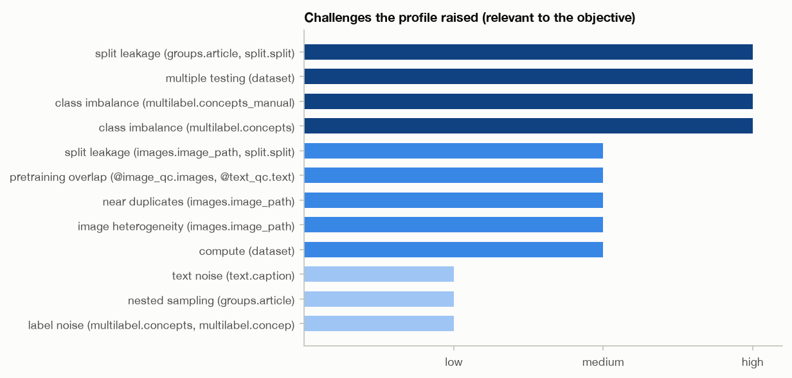
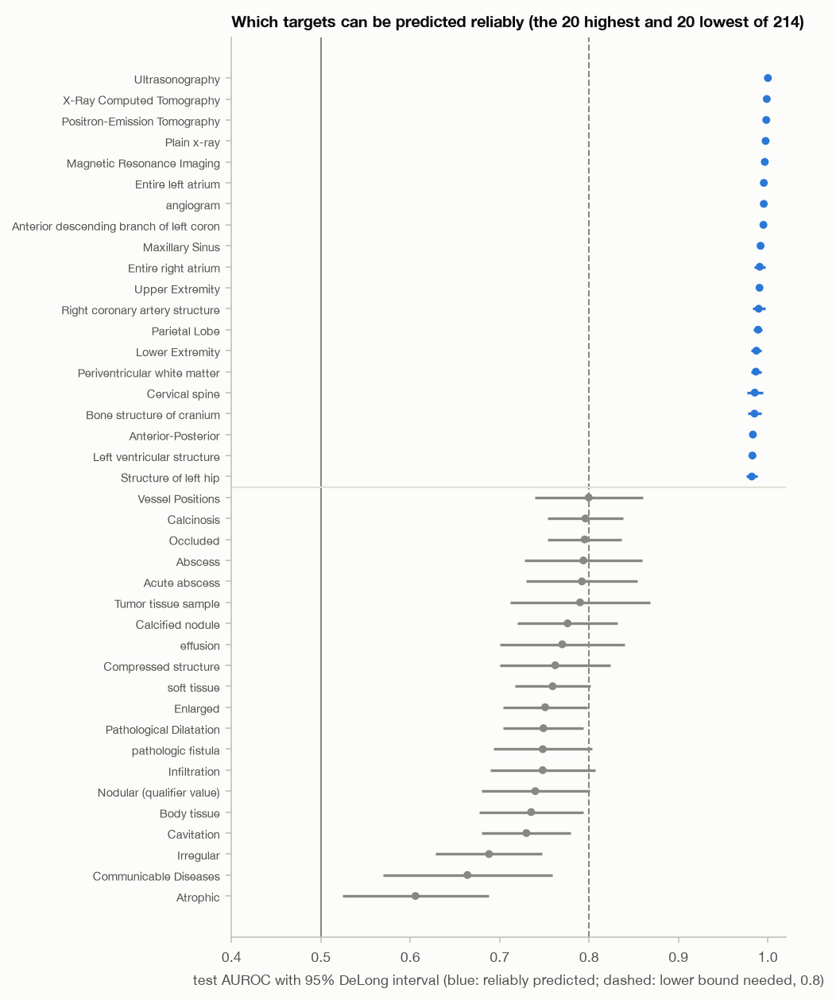
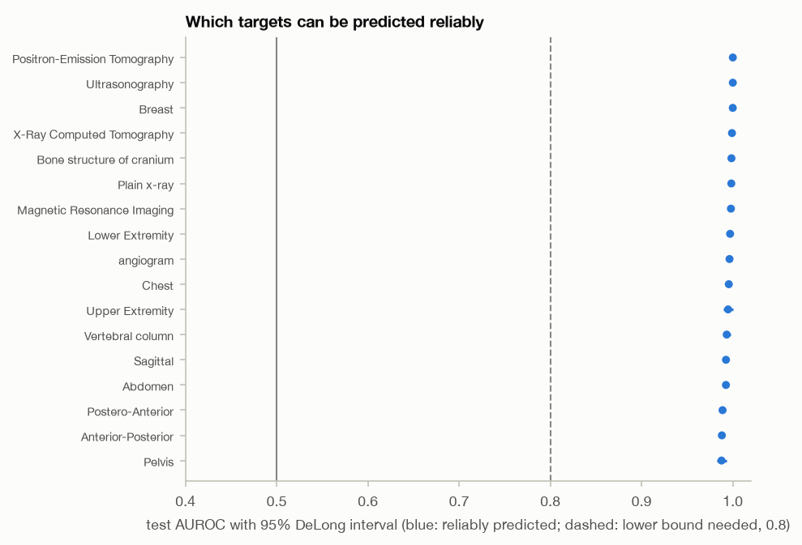
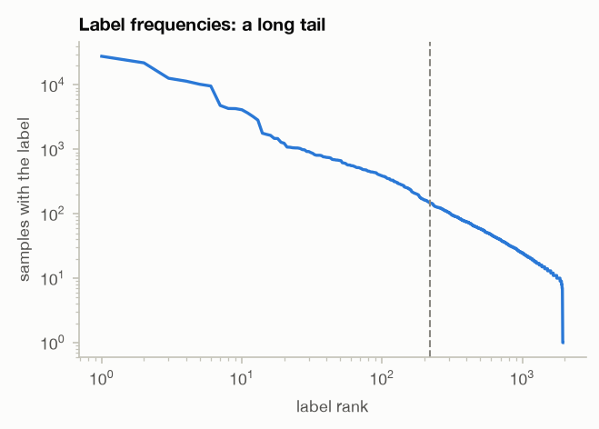
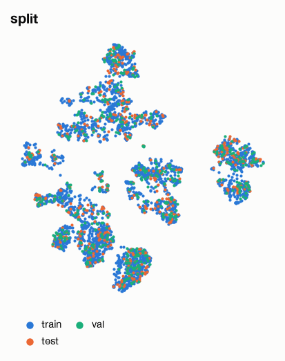

# Analysis report

table data, 79,789 samples; full mode; plan by the llm planner; LLM: claude-opus-5-5, 3 calls, $0.69 (3 replayed from the run's transcript at no new cost); 2026-11-02 19:03:27.

## Objective

> Determine which clinical concepts can be reliably predicted from images, and identify data-quality issues such as class imbalance, near-duplicates, and noisy captions.

| question | read from | about |
|---|---|---|
| predictive modelling | Determine which clinical concepts can be reliably predicted from images | features: images.image_path; labels: multilabel.concepts; reference: multilabel.concepts_manual |
| data quality audit | identify data-quality issues such as class imbalance, near-duplicates, and noisy captions | images: images.image_path; text: text.caption; labels: multilabel.concepts, multilabel.concepts_manual |
| visualization (implied) | (maps for the report) | features: images.image_path |

Fixed before any result (reliability rule): >= 20 positive evaluation samples, lower 95% DeLong bound of AUROC >= 0.8, BH-adjusted p < 0.05 against AUROC 0.5; fewer positives: too rare to assess.

## Executive summary

The run asked two questions: which clinical concepts can be reliably predicted from images, and what data-quality problems the set has (class imbalance, near-duplicates, noisy captions). It used 79,789 image–caption samples from 44,975 articles.

- **Automatic labels ('concepts').** Of 1,947 labels, 300 were modelled and 214 had at least 20 test positives, enough to judge. Under the pre-specified rule, **176 of those 214 were reliably predicted** and 38 were not. Test median AUROC was 0.940 (cross-validated median 0.943). 86 modelled targets and 1,647 untrained labels are too rare to assess.
- **Curated labels ('concepts_manual').** **All 17 assessable labels met the rule**, with test median AUROC 0.996.
- **Data quality.** Imbalance is severe (Gini 0.813; 89% of labels too rare to assess). 8.5% of images sit in near-duplicate clusters, and 6.4% of test images have a duplicate in training. About 64% of test and val samples share their article with another split. The two label sources agree closely (kappa 0.964), but that only covers 47% of the automatic label assignments. Caption-level flags are rare except a 20.3% "label unsupported by caption" rate.
- **Leakage.** Leakage-safe fitting changed median AUROC by only 0.000541 (concepts) and 0.000105 (manual).

Bottom line: a large subset of the frequent concepts is predictable from the image features. Two cautions apply. The verdicts are aggregate counts, with no per-concept intervals reported here. And the image encoder may have been pretrained on very similar figure–caption pairs.

## Data and challenges

**What the data profile showed, and the challenges it raised**

- **Article is the independent unit (low severity).** The 79,789 samples come from 44,975 articles, about 1.774 per article, and 67.6% of samples share their article with others. Handled in `predict` and `predict_manual` by grouped folds.
- **Article leakage across the predefined split (high).** 63.9% of the test split and 64.5% of the val split share their article with another split. Handled by setting fitting samples aside in both prediction steps (see the plan section).
- **Class imbalance in 'concepts' (high).**
  - 1,947 labels; the largest is 27,798 times the smallest; Gini 0.813.
  - The top 10% of labels hold 76.9% of assignments, and the effective number of labels is 208.116.
  - Only 221 labels have the support to be modelled and judged; 1,726 are below support (88.6%).
- **Class imbalance in 'concepts_manual' (high).** 18 labels, imbalance ratio 544.059, Gini 0.572, 17 assessable. 0.9% of samples carry no manual label.
- **Near-duplicate images (medium).** 0.5% of hashed images have a confirmed pixel-level near-copy (217 pairs out of 57,627 64-bit hash matches), and 57 of those pairs cross the split. With embedding-based pairs added, the `duplicates` step found:
  - 3,373 clusters containing 6,782 images (8.5%), largest cluster 6;
  - 949 clusters (28.1%) crossing splits and 57.6% crossing articles;
  - 6.4% of test images with a training duplicate.
  - Hash pairs and embedding pairs agree poorly: 92 pairs found by both methods, pair agreement 0.027. The two methods find largely different duplicates.
- **Label noise (low).** On the 18 shared labels across 79,061 samples, the two sources agree with micro kappa 0.964 (median 1.0). Taking the manual labels as reference, precision is 0.937 and recall 1.0, so the automatic labels over-assign rather than miss. Those labels cover only 46.8% of the automatic assignments; noise in the rest is unmeasured.
- **Caption noise (low).** 3.6% of captions are flagged:
  - too short 0.9% (removed);
  - duplicate 1.8%, of which 27.6% cross the split;
  - boilerplate 0.5%;
  - panel reference 1.2%.
  - The median caption is 17 words (95th percentile 49).
- **Image heterogeneity (medium).** Sizes are uniform: median 294 × 256 px, IQR ratio 1.0. In the profile sample 74% of images were greyscale; the feature step measured 75.4%. Image QC removed only 5 images, all for extreme aspect ratio (fraction 6.27e-05).
- **Multiple testing (high).** Handled by Benjamini–Hochberg within each family. The register quotes 1,721 modellable targets, but only 300 were actually modelled, and BH ran across the 214 assessable ones.
- **Not handled by any step:**
  - *Compute (medium):* the feature extraction was estimated at 3,521.6 s, 97.8% of the step budget.
  - *Pretraining overlap (medium, raised during execution):* zero-shot recall@10 reached 0.955 on held-out pairs, which suggests the encoder may have seen these or very similar pairs in pretraining.

Relevant challenges (all checks, including those that found nothing, are in challenge_register.md):

| challenge | severity | evidence | handled by | remaining risk |
|---|---|---|---|---|
| class_imbalance:multilabel.concepts | high | largest / smallest class size 27,798; share of labels too rare to assess 0.886 | imbalance_concepts, predict | 86 modelled targets too rare to assess |
| class_imbalance:multilabel.concepts_manual | high | largest / smallest class size 544; share of labels too rare to assess 0.0556 | imbalance_concepts_manual, predict_manual | 1 modelled targets too rare to assess |
| multiple_testing | high | hypotheses the questions imply: targets modelled 1,721 | predict, predict_manual | low: Benjamini-Hochberg FDR within every family of tests |
| split_leakage:groups.article,split.split | high | share of the test split whose article occurs in another split 0.639; share of the val split whose article occurs in another split 0.645 | duplicates, predict, predict_manual | 7921 fitting samples set aside; a fit with them gains 0.000541 median AUROC |
| compute | medium | largest declared tool cost / step budget 0.978; estimated seconds: multimodal_features 3,522 | - | not handled: no step of the plan applies |
| image_heterogeneity:images.image_path | medium | Q3 / Q1 of the shorter image side 1; share of the minority colour mode (greyscale vs colour) 0.258 | image_qc, features, atypical | handled; see the steps' results |
| near_duplicates:images.image_path | medium | share of images in a near-duplicate pair 0.00452; near-duplicate pairs crossing the split 57 | duplicates, predict, predict_manual | 0.085 of images in duplicate clusters, kept together in folds and splits |
| pretraining_overlap:features | medium | zero-shot recall@10 on held-out pairs 0.955 | - | zero-shot and retrieval scores may be optimistic |
| split_leakage:images.image_path,split.split | medium | near-duplicate pairs crossing the split 57 | duplicates, predict, predict_manual | 7921 fitting samples set aside; a fit with them gains 0.000541 median AUROC |
| label_noise:multilabel.concepts,multilabel.concepts_manual | low | Cohen's kappa between label sources 0.964; share of the first source's assignments on shared labels 0.468 | label_sources, caption_labels | kappa between sources 0.964; the rest is unmeasured |
| nested_sampling:groups.article | low | samples per independent unit (coarsest grouping) 1.77; article levels 44,975 | predict, predict_manual | folds and comparisons keep the independent unit whole |
| text_noise:text.caption | low | share of texts empty, very short, repeated, boilerplate or referring to panels 0.0358; share empty 0 | text_qc, caption_labels, image_text | handled; see the steps' results |

## Plan

**Audit steps**

- `image_qc` and `text_qc` removed only images that cannot be encoded (unreadable, shorter side under 32 px, aspect ratio over 5, blank) and only empty or very short captions. Repeated, boilerplate and panel-referencing captions were kept and reported, because they still carry information.
- `imbalance_concepts` and `imbalance_concepts_manual` counted which labels are assessable. A label needs at least 10 training positives to be modelled and at least 20 test positives to be judged.
- `duplicates` combined two methods:
  - difference-hash matches within 4 bits, confirmed at 256 bits;
  - mutual nearest neighbours in embedding space with cosine ≥ 0.947, a cutoff set at the median embedding cosine of the 217 confirmed pixel-level pairs.
- `label_sources` estimated label noise by agreement with the manual labels. `caption_labels` checked 300 labels against their captions (a label needs at least 20 positive training texts and a word with association z ≥ 3).
- `image_text` flagged image–caption pairs that match worse than random partners. `atypical` scored how unusual each image is with a cross-fitted density model on 57 principal components (90% of variance). The MAF density model was chosen over a Gaussian because its held-out log-likelihood was higher: −54.704 vs −81.719.

**Features**

Six candidate encoders were screened on held-out pairs without using labels. BiomedCLIP (pretrained on 15M PubMed Central figure–caption pairs) gave the best recall@10, 0.955 against a chance level of 0.02. No colour normalisation was applied because most images are greyscale.

**Prediction design (the main safeguards)**

- **Grouped folds.** Folds keep each article and near-duplicate cluster whole. Penalties were tuned by 3-fold inner cross-validation on training samples only. Models were fitted on the non-test splits and scored once on the test split.
- **Setting aside linked samples.** 7,921 non-test samples (11.3%; 7,811 in the manual run) share an article or duplicate cluster with test samples. They were left out of fitting, so no test sample was scored by a model that had seen its group. A second fit that kept them in measured how much the leak would inflate AUROC.
- **Reliability rule, fixed before any results.** A concept counts as reliably predicted if it has ≥ 20 test positives, the lower 95% DeLong bound of its AUROC is ≥ 0.8, and its BH-adjusted one-sided p-value against AUROC 0.5 is < 0.05.
- **Models.** Closed-form ridge with Platt scaling was used for the 300 most frequent concepts, because one eigendecomposition per fold fits all targets. Per-target logistic regression was used for the 18 manual labels.

**Changes the LLM planner made to the rule-based plan**

- It added `predict_manual`, reasoning that label noise in 'concepts' (precision 0.937) could push a concept's lower DeLong bound below 0.8. The cost was estimated at about 67 s.
- It bound article groups to `image_text`, because article-mates and captions repeated across splits (27.6% of duplicate captions) would otherwise inflate alignment scores. The zero-shot aligner was chosen in the end (`cross_fitted` false), so this grouping did not come into play.

**Map**

UMAP was chosen over the other candidate for the highest mean of trustworthiness and continuity among maps with seed stability ≥ 0.5.

**Not addressed:** the compute and pretraining-overlap challenges. Nothing was formally accepted as an open risk (0 accepted).

| # | step | tool | purpose | handles |
|---|---|---|---|---|
| 1 | image_qc | qc_images | Flag and remove unreadable, tiny, strip-shaped and blank images; the pass also hashes every image for the duplicate audit. | image_heterogeneity:images.image_path |
| 2 | text_qc | qc_text | Remove empty and very short captions; flag repeated, boilerplate and panel-referencing ones. | text_noise:text.caption |
| 3 | features | multimodal_features | Screen pretrained encoders on held-out pairs (label-free) and extract image and caption features. | image_heterogeneity:images.image_path |
| 4 | imbalance_concepts | label_imbalance | Frequency audit of 'concepts': imbalance, long tail and how many labels have the support to be judged. | class_imbalance:multilabel.concepts |
| 5 | imbalance_concepts_manual | label_imbalance | Frequency audit of 'concepts_manual': imbalance, long tail and how many labels have the support to be judged. | class_imbalance:multilabel.concepts_manual |
| 6 | duplicates | near_duplicates | Find near-duplicate images (confirmed hashes, calibrated embedding cosine); clusters crossing splits or articles are leakage. | near_duplicates:images.image_path, split_leakage:groups.article,split.split, split_leakage:images.image_path,split.split |
| 7 | label_sources | label_agreement | Agreement of 'concepts' with 'concepts_manual' per shared label: an estimate of label noise. | label_noise:multilabel.concepts,multilabel.concepts_manual |
| 8 | caption_labels | caption_label_consistency | Flag labels their caption does not support or negates, and captions naming a label the sample lacks. | label_noise:multilabel.concepts,multilabel.concepts_manual, text_noise:text.caption |
| 9 | image_text | multimodal_agreement | Flag image-caption pairs that match worse than random partners (noisy or mismatched captions), with articles kept together in cross-fitting. | text_noise:text.caption |
| 10 | atypical | generative_density | Score how atypical every image is under a cross-fitted density model, as a quality signal next to the QC flags. | image_heterogeneity:images.image_path |
| 11 | predict | predict_targets | Predict 'concepts' from image features with article- and duplicate-grouped folds, a single test evaluation, BH control and the configured reliability rule. | nested_sampling:groups.article, class_imbalance:multilabel.concepts, near_duplicates:images.image_path, split_leakage:groups.article,split.split, split_leakage:images.image_path,split.split, multiple_testing |
| 12 | predict_manual | predict_targets | Predict the 18 manually curated concepts from image features under the same leakage-safe design, to check reliability verdicts against cleaner labels. | nested_sampling:groups.article, class_imbalance:multilabel.concepts_manual, near_duplicates:images.image_path, split_leakage:groups.article,split.split, split_leakage:images.image_path,split.split, multiple_testing |
| 13 | map | dimreduce_map | A two-dimensional map of the image features for the report. | - |

## Results

**Predictive modelling: 'concepts' (test split, 9,925 samples)**

- 300 targets were modelled and 1,647 were too rare to train. Of the 300, 214 were assessable and 86 were too rare to assess.
- 176 of the 214 met the reliability rule and 38 did not.
- Test median AUROC was 0.940, far above chance (0.5) and above the rule's 0.8 bar. It agrees closely with the cross-validated median of 0.943, so the single test evaluation is consistent with model selection.
- Median AUPRC lift over prevalence was 20.971. Median Brier skill was only 0.046: the calibrated probabilities improve only slightly on a prevalence-only forecast, even though ranking (AUROC) is strong.
- The record reports medians and counts only. It does not report per-concept AUROCs, DeLong intervals, or which concepts are reliable, so this section cannot list them.

**Predictive modelling: 'concepts_manual' (test split, 9,820 samples)**

- All 17 assessable labels were reliable; 1 was too rare to assess.
- Test median AUROC was 0.996 (cross-validated 0.996), AUPRC lift 21.609, Brier skill 0.774.
- This agrees with the verdicts on the automatic labels. However, the manual set has 18 broad labels against the 300 finest-grained frequent concepts, so the higher scores probably reflect coarser targets as well as cleaner labels.

**Leakage**

65.5% of test samples (65.3% in the manual run) have an article or duplicate group-mate outside the test split. Keeping those mates in the fit raised median AUROC by only 0.000541 (concepts) and 0.000105 (manual). So, on the median, leakage does not inflate the reported performance. Effects on individual concepts are not reported.

**Data-quality audit**

- **Imbalance.** Severe, as described in the data section. Most of the label vocabulary (88.6%) cannot be assessed at all.
- **Near-duplicates.** 8.5% of images are in clusters, and 6.4% of test images have a training duplicate. The two detection methods agree weakly (pair agreement 0.027), so the cluster count depends on the method.
- **Captions against labels.**
  - 20.3% of checked labels are not supported by their caption (19.7% on held-out texts); 0.6% are negated by it; 0.1% may be missing.
  - 45.5% of captions carry at least one flag.
  - Validated against the manual labels, the flag points the wrong way. Flagged labels were absent from the manual set in 2.3% of cases, compared with 8.1% for labels the caption supports. "Unsupported by caption" therefore does not indicate a label error; it mostly reflects captions that leave visible content unstated.
- **Image–caption mismatch.** The zero-shot aligner reached validation recall@10 of 0.887 (chance 0.005). Only 14 pairs (0.018%) matched worse than random partners. The rate was slightly higher in the test split (0.061%) than in training (0.008%).
- **Atypical images.** The density model flagged 653 images (0.8%). The rate is similar across splits: 0.8% train, 1.0% val, 1.0% test.

**Map**

The UMAP map preserves local neighbourhoods well: trustworthiness 0.977 and continuity 0.972 at k=10. It is only marginally stable across seeds (0.533 against a 0.5 threshold), and global distances are weakly preserved (Spearman 0.353). It should be read for local structure only.

### Predictive modelling

- **predict** (predict_targets): model ridge, n reliable 176, n assessed 214, n too rare to assess 86, median auroc 0.94, cv auroc median 0.943
  - criteria: cv_auroc_median 0.943; n_reliable 176 [report only]; median_auroc 0.94 [report only]; leakage_gap_median 0.000541 [report only]

- **predict_manual** (predict_targets): model logistic, n reliable 17, n assessed 17, n too rare to assess 1, median auroc 0.996, cv auroc median 0.996
  - criteria: cv_auroc_median 0.996; n_reliable 17 [report only]; median_auroc 0.996 [report only]; leakage_gap_median 0.000105 [report only]

### Data quality audit

- **image_qc** (qc_images): n removed 5, fraction removed 6.27e-05
  - criteria: fraction_removed 6.27e-05 (met); max_group_fraction_removed 0.000202 (met); size_iqr_ratio 1
- **text_qc** (qc_text): fraction removed 0.00929, fraction duplicate 0.0184, fraction panel reference 0.012
  - criteria: fraction_removed 0.00929 (met); fraction_duplicate 0.0184; fraction_panel_reference 0.012; cross_split_duplicate_fraction 0.276
- **imbalance_concepts** (label_imbalance): n labels used 1,947, imbalance ratio 27,798, gini 0.813, n assessable 221
  - criteria: imbalance_ratio 27,798; gini 0.813; n_assessable 221

- **imbalance_concepts_manual** (label_imbalance): n labels used 18, imbalance ratio 544, gini 0.572, n assessable 17
  - criteria: imbalance_ratio 544; gini 0.572; n_assessable 17
- **duplicates** (near_duplicates): n clusters 3,373, fraction in clusters 0.085, n hash pairs 217, n embedding pairs 3,311, cross split clusters 949
  - criteria: fraction_in_clusters 0.085; test_with_train_duplicate_fraction 0.0639; pair_agreement 0.0268; cross_group_cluster_fraction 0.576
- **label_sources** (label_agreement): kappa micro 0.964, n shared labels 18, precision micro 0.937, recall micro 1
  - criteria: kappa_micro 0.964; kappa_median 1; precision_micro 0.937; recall_micro 1
- **caption_labels** (caption_label_consistency): n labels checked 300, unsupported rate 0.203, negated rate 0.00562, possible missing rate 0.00121
  - criteria: unsupported_rate 0.203; negated_rate 0.00562; reference_absent_given_flagged 0.023 [report only]; reference_absent_given_supported 0.0813 [report only]
- **image_text** (multimodal_agreement): aligner zero_shot, val recall at 10 0.887, flagged fraction 0.000177
  - criteria: val_recall_at_10 0.887; flagged_fraction 0.000177
- **atypical** (generative_density): model maf, val loglik gain 27, flagged fraction 0.00818
  - criteria: val_loglik_gain 27 (met); flagged_fraction 0.00818

### Visualization

- **map** (dimreduce_map): method umap, trustworthiness@10 0.977, continuity@10 0.972, stability 0.533
  - criteria: trustworthiness@10 0.977 (met); continuity@10 0.972; stability 0.533 (met); distance_spearman 0.353

## Critic and revision

The critic found 0 triggers and did not try a revision.

Its assessment was that the results answer the objective:
- 176 of 214 assessable concepts are reliable (test median AUROC 0.940, cross-validated 0.943);
- all 17 manual concepts are reliable (AUROC 0.996);
- leakage gaps are negligible (≤ 0.0005), so the grouped, duplicate-aware design holds;
- the audit covers imbalance (Gini 0.81), near-duplicates (8.5% of images) and the other named issues.

Because no revision ran, the reported results are those of the original plan. The critic did not comment on two open challenges: possible pretraining overlap of the encoder and the compute budget.

## Limitations

- **Aggregate results only.** Results are medians and counts. Per-concept AUROCs, DeLong intervals and the names of the 176 reliable concepts are not in this record, and the medians have no uncertainty intervals.
- **Most of the vocabulary goes unjudged.** Only 300 of 1,947 concepts were modelled and 214 assessed. The 1,647 untrained labels and 86 too-rare labels, roughly 89% of the vocabulary, have no verdict. "Not assessed" does not mean "not predictable".
- **Count mismatch.** The imbalance audit counted 221 assessable labels, but the prediction step assessed 214. The record does not explain the difference.
- **Weak probabilistic skill.** Median Brier skill for 'concepts' was 0.046, so probability outputs should not be used as calibrated risks, despite the high AUROC.
- **Possible pretraining overlap (not handled).** BiomedCLIP was pretrained on PubMed Central figure–caption pairs, and zero-shot recall@10 of 0.955 suggests these or similar pairs may have been seen. Image–text agreement scores, and possibly the predictive performance, may be optimistic. No step tested this.
- **Partial label-noise coverage.** The manual reference covers only 46.8% of automatic label assignments, so noise in the rest is unmeasured. The comparison with manual labels also mixes label quality with label granularity.
- **Caption-consistency flag not validated.** It does not track label errors in the reference (2.3% vs 8.1% reference-absent), so the 20.3% unsupported rate should not be read as a label-error rate.
- **Duplicate detection depends on method.** Hash and embedding pairs agree poorly (0.027), and the embedding cutoff of 0.947 was calibrated on only 217 pairs. Some duplicates may be missed or spurious.
- **Leakage measured only at the median.** The gaps of 0.000541 and 0.000105 are medians; individual concepts may be affected more.
- **Compute challenge not handled.** The record shows no consequence, but the feature step had little budget margin.
- **Map caveats.** Seed stability was only 0.533 and global distances are weakly preserved (Spearman 0.353).

## Reproducibility

- Seed 774; full budgets; device mps; Python 3.12.14; run time 646 s.
- Planner: llm; LLM calls 3 (3 from cache); replay with `--replay` on this run's directory or transcript.
- Files: profile.json, objective.json, challenge_register.(json|md), analysis_plan.(json|md), evaluation.json, decision_log.json, methods_summary.md, 15 tables in tables/, 5 figures in figures/, 5 result files in results/.

## Numbers not found in the outputs

196 numbers in the prose were checked against the computed record (LLM (claude-opus-5-5)); 0 not found.
